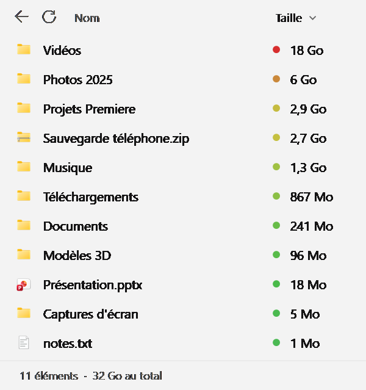

# Pesée

**Le poids de chaque dossier, d'un clic droit dans l'Explorateur Windows.**

Clic droit dans un dossier → **Analyser la taille** : une petite fenêtre liste les sous-dossiers et fichiers,
dans le même ordre que l'Explorateur, avec leur poids et une pastille de couleur
(vert = léger, rouge = lourd, par rapport au plus gros élément du dossier).



- Analyse en parallèle sur tous les cœurs du processeur, tailles affichées en direct.
- Ne modifie et ne supprime rien. Aucune donnée collectée ni envoyée, aucune connexion Internet.
- Installation pour votre compte uniquement, sans droits administrateur.
- Windows 10 et 11. Interface en français.

## Installation

Téléchargez la dernière version dans [Releases](../../releases), puis au choix :

### Version PowerShell (recommandée)

Fonctionne même quand Windows bloque les applications non signées (Smart App Control).

1. Téléchargez `Pesee-<version>.zip` et décompressez-le.
2. Clic droit sur `install.ps1` → **Exécuter avec PowerShell**.
   Si rien ne se passe, ouvrez PowerShell dans le dossier décompressé et tapez :
   ```
   powershell -NoProfile -ExecutionPolicy Bypass -File install.ps1
   ```

Désinstallation : même chose avec `uninstall.ps1`.

### Version .exe

Téléchargez `Pesee.exe` et double-cliquez : il propose d'ajouter « Analyser la taille » au clic droit.
Désinstallation depuis **Paramètres > Applications**.

> Pesee.exe n'est pas signé numériquement. Windows peut afficher « Windows a protégé votre ordinateur »
> (cliquez sur **Informations complémentaires** → **Exécuter quand même**), et Smart App Control le bloque
> complètement : utilisez alors la version PowerShell.

Une version **Microsoft Store** est en préparation : signée par Microsoft, avec « Analyser la taille »
directement dans le menu principal du clic droit de Windows 11.

## Utilisation

- Windows 11 : clic droit → **Afficher plus d'options** (ou **Maj + clic droit**) → **Analyser la taille**.
  Fonctionne sur un dossier, dans le vide d'un dossier ou sur un disque.
- Double-clic sur un dossier : on entre dedans. Retour : flèche en haut à gauche, touche Retour arrière
  ou bouton « précédent » de la souris.
- Clic sur **Taille** : tri du plus lourd au plus léger. Clic sur **Nom** : ordre de l'Explorateur.
- Clic droit sur une ligne : analyser, ouvrir ou afficher dans l'Explorateur, copier le chemin.
- Survol d'une ligne : détail en bas (nombre de fichiers et de dossiers).
- Taper les premières lettres d'un nom le sélectionne. F5 : relancer l'analyse. Échap : fermer.

## Fonctionnement

- Application WinForms en C# (.NET Framework 4.8, présent sur tous les Windows 10 et 11), sans dépendance.
- L'analyse parcourt les sous-dossiers en parallèle (API `FindFirstFileEx`), sans suivre les jonctions
  ni les liens symboliques (pas de boucle ni de double comptage).
- Taille affichée = taille réelle des fichiers (comme la colonne « Taille » de l'Explorateur), en Ko/Mo/Go de 1024.
- Les éléments cachés suivent le réglage de l'Explorateur.
- `Pesee.ps1` compile en mémoire le code de `src\` puis l'exécute dans PowerShell : c'est ce qui permet
  à la version PowerShell de fonctionner avec Smart App Control.

## Compiler

Aucun SDK nécessaire pour la version classique : le compilateur C# est fourni avec Windows.

```
powershell -NoProfile -ExecutionPolicy Bypass -File build.ps1        # -> bin\Pesee.exe
powershell -NoProfile -ExecutionPolicy Bypass -File build-release.ps1 # -> release\ (zip + exe)
```

Paquet Microsoft Store (`build-store.ps1`) : nécessite le Windows SDK et Visual Studio Build Tools (C++),
voir [store/SOUMISSION.md](store/SOUMISSION.md).

| Dossier | Contenu |
|---|---|
| `src\` | Code de l'application |
| `menu\` | Module du clic droit Windows 11 (version Store) |
| `store\` | Manifeste et guide de publication Microsoft Store |
| `tools\` | Génération de l'icône et des logos |
| `res\` | Icône et manifeste de l'exécutable |

## Licence

[MIT](LICENSE)
